# MARO (마로)

### 다문화 가정의 의료 접근성을 높이는 아동 예방접종 관리 Android 서비스

MARO는 언어와 정보 접근의 어려움을 겪는 다문화 가정을 위한 **아동 예방접종 통합 관리 서비스**입니다.

아동별 예방접종 일정 관리와 주변 접종기관 탐색 기능을 제공하며, AI 챗봇과 전화 연습 기능을 통해 보호자가 의료 정보를 이해하고 실제 의료기관을 이용하는 과정을 돕습니다.

**[MARO 시연 영상](https://youtu.be/C_7E7TXHkB0)**


<p align="center">
  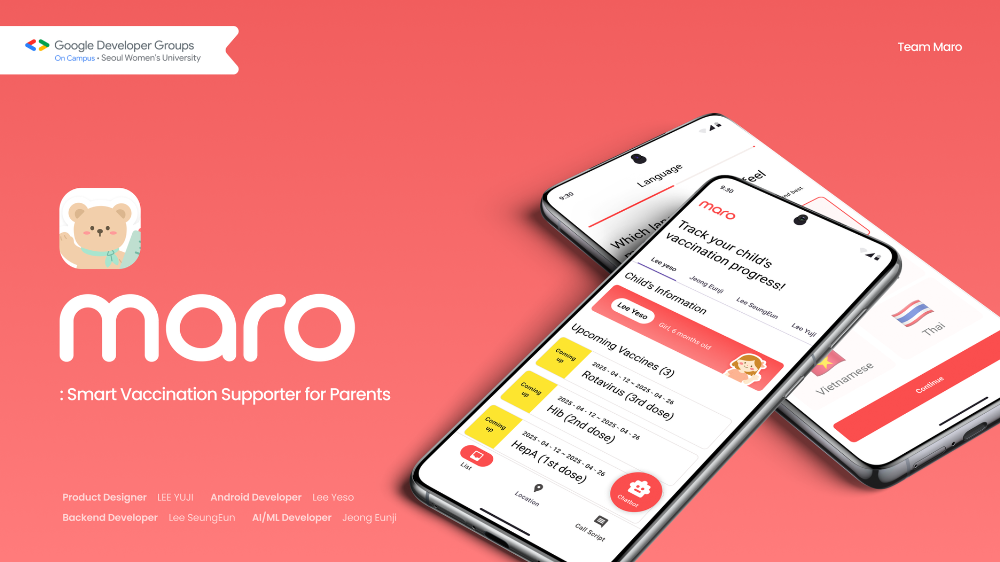
</p>

---

### Project Information

| 항목 | 내용 |
|---|---|
| 프로젝트 | 2025 Google Solution Challenge · MARO |
| 개발 기간 | YYYY.MM – YYYY.MM (입력 필요) |
| 팀 구성 | 4명 |
| 담당 역할 | Android Frontend Development · Service Planning |

**My Contributions**
- Android 프론트엔드 단독 개발
- 아동별 예방접종 일정 및 기록 관리 UI 구현
- 위치 기반 의료기관 탐색 및 지도 화면 구현
- AI 챗봇·CallScript·예방접종 증명서 분석 기능의 클라이언트 연동
- 다국어 UI 적용 및 실제 기기 환경 테스트
- 서비스 기능 기획 및 사용자 흐름 설계 참여

**Team Contributions**
- AI/ML: 챗봇, 전화 연습용 대화·음성 생성, 증명서 분석 기능
- Backend: 의료기관 데이터 조회, 공공데이터 및 AI 서버 연계
- UX/UI: 화면 디자인 및 그래픽 에셋 제작

※ 팀 전체 기능과 개인 구현 범위를 구분하여 작성했습니다.

---

## 🔍 Problem & Research

### 언어와 정보의 장벽으로 어려움을 겪는 다문화 가정의 예방접종 관리

MARO 팀은 다문화 가정 보호자가 아동의 예방접종 정보를 이해하고 실제 의료기관을 이용하는 과정에서 겪는 어려움에 주목했습니다.

통계청 자료에 따르면 국내 다문화 가구는 **2015년 299,241가구에서 2023년 415,584가구로 약 39% 증가**했습니다. 그러나 한국의 의료체계와 언어에 익숙하지 않은 보호자는 예방접종 일정 확인부터 의료기관 문의까지 여러 장벽을 경험할 수 있습니다.

<!-- 이미지 추가: 다문화 가구 추이 자료 또는 기획 배경 그래프 -->

### Background Research

| 조사 내용 | 주요 발견 |
|---|---|
| 다문화 가구 증가 | 2015년 대비 2023년 약 39% 증가 |
| 의료 정보 접근 | 전문적인 의료 용어와 한국어 중심의 정보 제공으로 이해에 어려움 발생 |
| 의료기관 이용 | 병원 문의 및 예약 과정에서 언어 장벽 발생 |
| 예방접종 관리 | 아동별 일정과 접종 이력을 보호자가 직접 확인하고 관리해야 하는 부담 |

*참고: 통계청 인구총조사(2023), 「다문화가족의 건강요구에 기반한 정책 및 ICT 활용방안」 관련 선행연구*

### Problem Definition

기존 자료 조사와 관련 연구를 통해 세 가지 핵심 문제를 정의했습니다.

1. **의료 정보 접근의 어려움** — 한국어 중심의 예방접종 정보와 전문 용어로 인해 필요한 내용을 이해하기 어려움
2. **의료기관 이용의 언어 장벽** — 병원을 찾더라도 전화 문의나 의료진과의 의사소통에 어려움 발생
3. **예방접종 관리의 부담** — 자녀별 접종 일정과 기록을 확인하고 지속적으로 관리하기 어려움

MARO는 이러한 문제를 해결하기 위해 **정보 확인 → 일정 관리 → 의료기관 탐색 → 의사소통 지원**으로 이어지는 통합 예방접종 관리 서비스를 기획했습니다.

---

## 💡 Solution

### 예방접종 정보 확인부터 실제 의료기관 이용까지

MARO는 다문화 가정 보호자가 예방접종 과정에서 겪는 언어와 정보의 장벽을 줄이기 위해 **정보 확인 → 일정 관리 → 의료기관 탐색 → 의사소통 지원**으로 이어지는 서비스를 설계했습니다.

단순히 예방접종 정보를 제공하는 데 그치지 않고, 보호자가 필요한 정보를 이해하고 실제 접종까지 이어갈 수 있도록 기능을 구성했습니다.

| 핵심 기능 | 해결하고자 한 문제 | 제공 기능 |
|---|---|---|
| **다국어 지원** | 한국어 중심의 의료 정보로 인한 접근성 문제 | 한국어·영어·중국어·일본어·베트남어·태국어 지원 |
| **아동별 예방접종 관리** | 자녀별 접종 일정 및 이력 관리의 어려움 | 생년월일 기반 일정 생성, 접종 상태 관리, 캘린더 연동 |
| **주변 접종기관 탐색** | 접종 가능한 의료기관을 찾고 정보를 확인하는 어려움 | 위치 기반 의료기관 검색, 접종 정보 및 상세 정보 제공 |
| **AI 전화 연습(CallScript)** | 병원 전화 문의 과정의 언어 장벽 | 예상 질문·답변 생성, 번역 및 한국어 음성 제공 |
| **AI 예방접종 챗봇** | 예방접종 및 다문화 지원 정책 정보 이해의 어려움 | RAG 기반 질의응답 및 이미지 기반 상담 보조 |
| **예방접종 증명서 확인** | 접종 이력을 직접 확인하고 기록해야 하는 부담 | 증명서 이미지 분석 및 접종 정보 확인·기록 |

이러한 기능을 통해 보호자가 **자녀의 접종 일정을 파악하고, 필요한 의료기관을 찾고, 의료진과 소통하는 과정**을 하나의 앱에서 지원하고자 했습니다.

---

## My Contributions

**Role: Android Frontend Developer / Service Planning**

MARO의 서비스 기획에 참여하고, **Android 프론트엔드 개발을 단독으로 담당**했습니다.

아동별 예방접종 일정 관리부터 의료기관 탐색, AI 기능 연동까지 주요 화면을 구현했으며, 백엔드·AI·디자인 담당자와 협업해 각 기능을 하나의 앱으로 연결했습니다.

### 01. Vaccination Management — 아동별 예방접종 관리

아동의 정보를 기반으로 예방접종 일정을 생성하고, 보호자가 자녀별 접종 상태와 기록을 확인할 수 있는 화면을 구현했습니다.

**주요 구현 내용**
- Room DB를 활용한 아동별 예방접종 정보 저장 및 조회
- 생년월일 기반 예방접종 일정 생성 및 자녀별 목록 관리
- RecyclerView를 활용한 접종 목록 및 상세 화면 구성
- 접종 상태별 필터링과 예정 일정 확인
- Android 캘린더 앱과 예방접종 일정 등록 기능 연동

**구현 과정에서 고려한 점**

여러 자녀의 접종 정보가 섞이지 않도록 아동 ID를 기준으로 데이터를 구분했습니다.

예방접종 정보는 Room DB에 저장하여 주요 화면에서 반복적으로 조회할 수 있도록 했으며, 보호자가 접종 상태와 예정 일정을 쉽게 구분할 수 있도록 목록과 상세 화면을 구성했습니다.

<p align="center">
  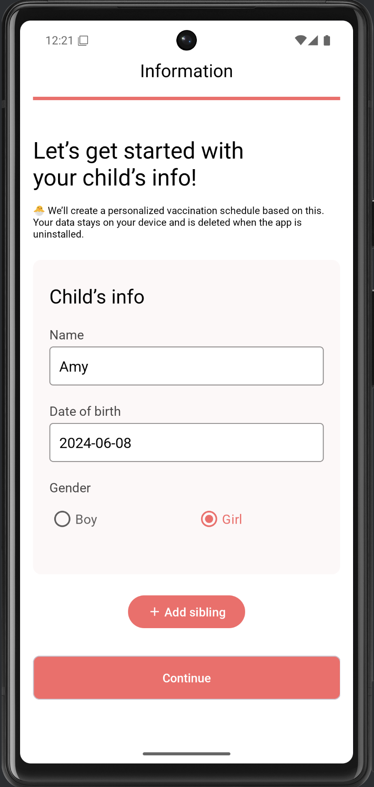
  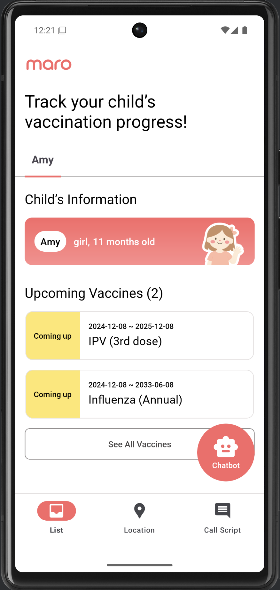
  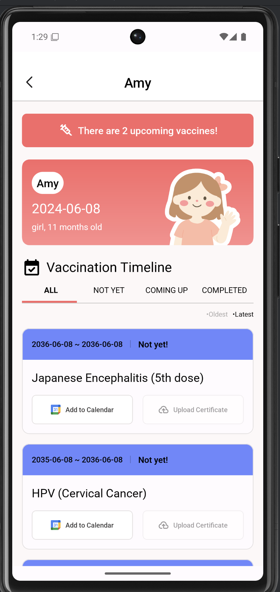
  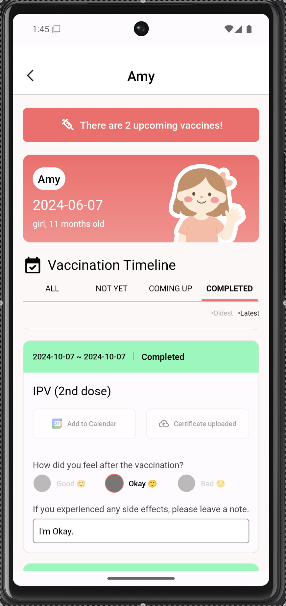
</p>
<p align="center">
  <sub>아동 정보 등록 / 예방접종 메인 / 접종 전체 목록 / 접종 기록 관리</sub>
</p>

### 02. Hospital Finder — 위치 기반 의료기관 탐색

예방접종 정보를 확인한 보호자가 실제 접종기관까지 찾아갈 수 있도록 위치 기반 의료기관 탐색 기능을 제안하고 구현했습니다.

**주요 구현 내용**
- Google Maps SDK를 활용한 의료기관 지도 화면 구현
- 사용자 위치 기반 주변 의료기관 조회 API 연동
- 의료기관 목록 및 상세 정보 표시
- 병원별 접종 가능 정보와 운영 정보 UI 구성
- 지도 앱을 통한 길찾기 기능 연결

**구현 과정에서 고려한 점**

의료기관 위치만 제공하는 것보다 실제 접종에 필요한 정보를 함께 확인할 수 있도록 구성했습니다.

서버에서 전달받은 의료기관 데이터와 접종 정보를 화면에 표시하고, 사용자가 지도와 상세 정보를 오가며 필요한 기관을 선택할 수 있도록 구현했습니다.


<p align="center">
  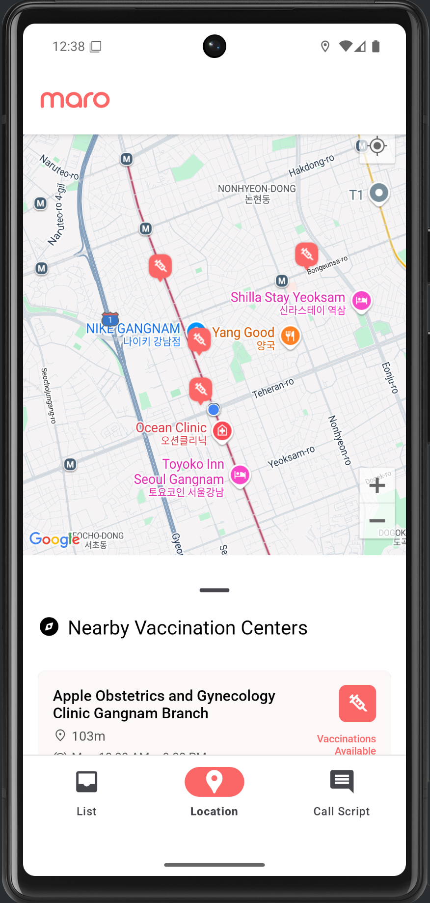
  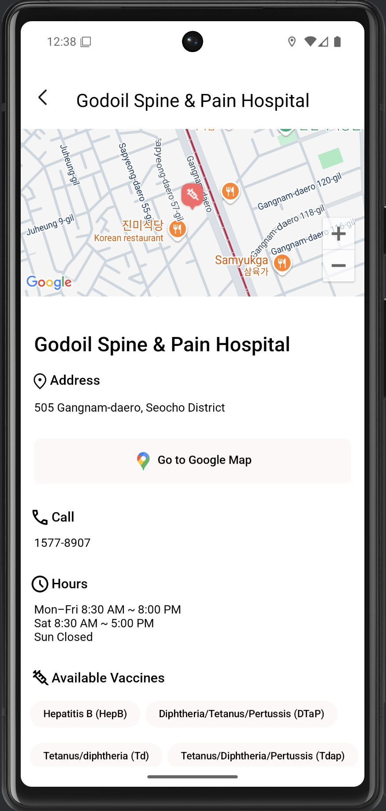
</p>
<p align="center">
  <sub>주변 의료기관 탐색 / 의료기관 상세 정보</sub>
</p>


### 03. AI Feature Integration — AI 기능 연동

AI 담당자가 개발한 챗봇, CallScript, 예방접종 증명서 분석 기능을 Android 화면에서 사용할 수 있도록 클라이언트 기능과 API 연동을 구현했습니다.

**주요 구현 내용**
- Retrofit을 활용한 AI 기능 요청·응답 연동
- 챗봇의 텍스트·이미지 입력 및 응답 화면 구현
- CallScript의 예상 답변·번역·키워드 표시 UI 구현
- AI가 생성한 음성 데이터 재생 기능 연결
- 예방접종 증명서 이미지 업로드 및 확인 결과 표시
- 이미지·텍스트 복합 요청을 위한 multipart 통신 처리

**구현 과정에서 고려한 점**

기능마다 주고받는 데이터가 달라 백엔드·AI 담당자와 요청·응답 형식을 조율해야 했습니다.

텍스트 질문, 이미지 첨부, 음성 데이터 등 서로 다른 데이터 형식을 클라이언트에서 처리하고, 서버 결과가 실제 화면에 정상적으로 표시되는지 확인하며 연동 오류를 수정했습니다.


<p align="center">
  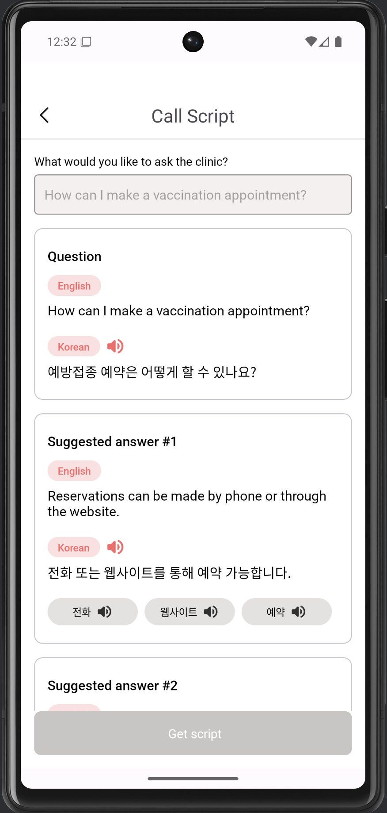
  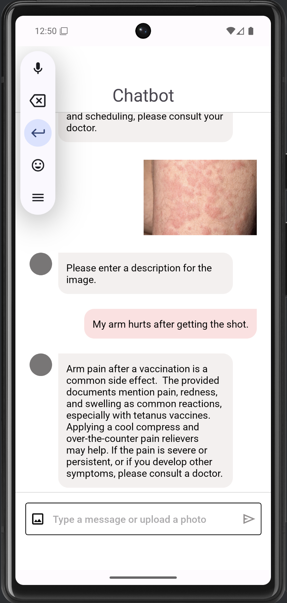
  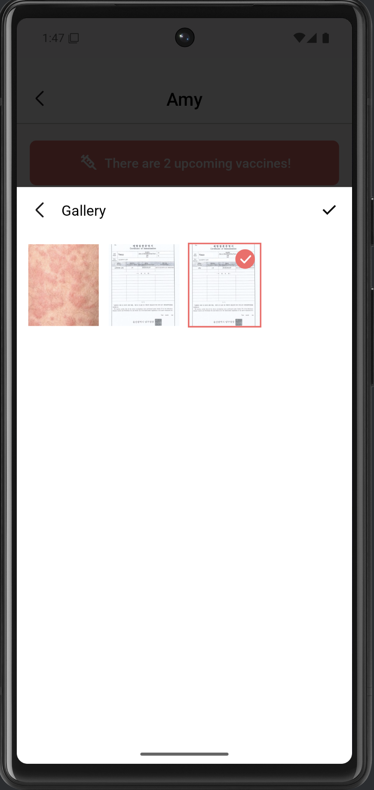
</p>
<p align="center">
  <sub>CallScript 예상 답변 및 음성 / 이미지 기반 AI 챗봇 / 예방접종 증명서 선택</sub>
</p>


### 04. Multilingual UI & Onboarding — 다국어 지원 및 초기 이용 흐름

다양한 언어를 사용하는 보호자가 앱을 이용할 수 있도록 언어 선택과 온보딩 화면을 구현했습니다.

**주요 구현 내용**
- 한국어·영어·중국어·일본어·베트남어·태국어 문자열 리소스 적용
- SharedPreferences를 활용한 사용자 언어 설정 저장
- 사용자 선택 언어에 따른 Locale 설정 및 다국어 문자열 리소스 적용
- 초기 언어 선택 및 아동 정보 등록 화면 구현
- 서버 요청 시 선택 언어 코드 전달
- 실제 기기 및 일부 언어에서 텍스트·레이아웃 확인

**구현 과정에서 고려한 점**

동일한 화면도 언어에 따라 문장 길이가 달라지기 때문에 고정된 UI 크기만으로는 정상적인 표시를 보장하기 어려웠습니다.

일부 실제 기기와 언어 환경에서 확인한 텍스트 잘림과 키보드 겹침 문제를 수정했습니다. 모든 기기와 지원 언어를 대상으로 검증한 것은 아닙니다.


<p align="center">
  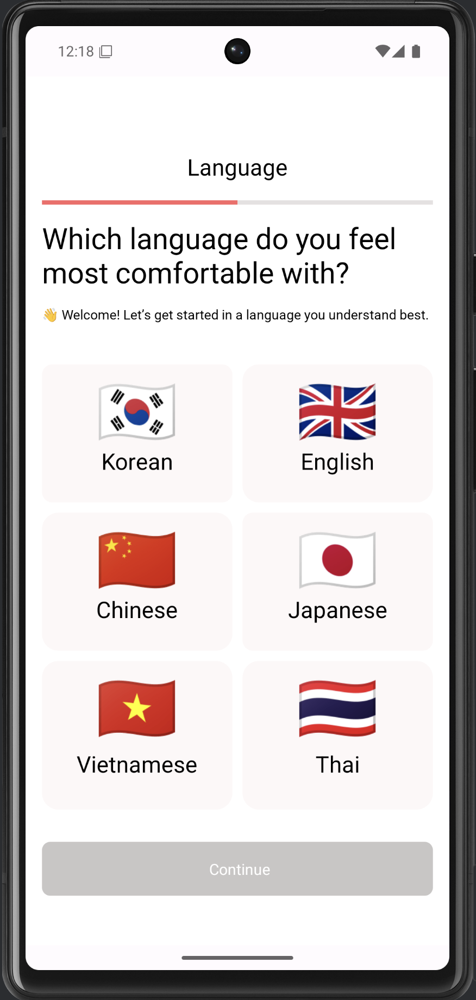
  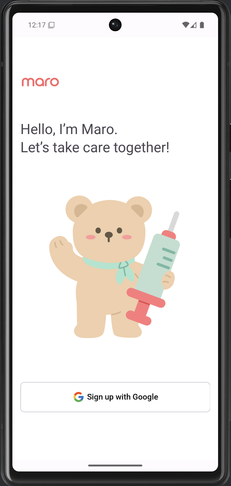
  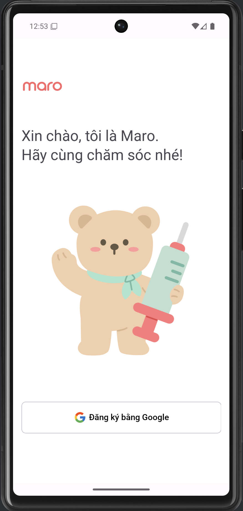
</p>
<p align="center">
  <sub>언어 선택 / 영어 적용 / 베트남어 적용</sub>
</p>

---

## Technical Challenges

### 01. 백엔드·AI 파트 간 API 연동 규격 조율

**Problem**

MARO는 Android, Backend, AI 파트가 각각 개발한 기능을 하나의 앱으로 통합해야 했습니다.

개발 초기에는 기능별 요청·응답 데이터 형식이 충분히 정리되지 않아 API 연동 오류가 반복되었습니다. 특히 예방접종 증명서 검증, AI 챗봇, 의료기관 정보 조회는 필요한 데이터와 전송 방식이 서로 달랐습니다.

**Solution**

화면마다 개별적으로 오류를 수정하기보다, 백엔드·AI 담당자와 기능별 데이터 흐름을 다시 확인했습니다.

- 기능별로 필요한 요청 값과 응답 데이터 구조를 정리
- 이미지와 텍스트를 함께 전달해야 하는 기능에 `multipart/form-data` 방식 적용
- 서버 응답에 맞춰 Android API 인터페이스 및 데이터 처리 코드 수정
- 실제 화면에서 요청·응답 결과를 확인하고 팀원들과 공유하며 연동 오류 해결

**Result**

서로 다른 파트에서 구현한 예방접종 정보, AI 챗봇, CallScript, 증명서 확인 기능을 Android 앱에 연결했습니다.

이 과정에서 **개별 화면의 기능 구현뿐 아니라, 시스템 간 데이터 형식을 맞추고 실제 UI에서 결과를 검증하는 과정**이 중요하다는 점을 배웠습니다.

### 02. 실제 기기 및 다국어 환경에서 발생한 UI 오류 개선

**Problem**

초기 개발 과정에서 일정상의 이유로 에뮬레이터 테스트에 집중했습니다.

그러나 실제 기기에서 확인했을 때 일부 버튼의 터치 영역이 좁았고, 키보드가 주요 UI를 가리는 문제가 발생했습니다. 또한 일부 언어에서는 번역된 문장이 기존 레이아웃보다 길어 텍스트가 잘리거나 화면 구성이 깨졌습니다.

**Solution**

- 버튼의 터치 영역을 확대하여 조작 편의성 개선
- 키보드 노출에 따라 화면이 이동하도록 레이아웃 수정
- 고정된 텍스트 영역을 콘텐츠 길이에 따라 확장되도록 변경
- 수정된 화면을 실제 기기와 일부 언어 설정에서 다시 확인

**Result**

테스트 과정에서 발견한 터치 영역, 키보드 겹침, 텍스트 표시 문제를 수정했습니다.

이를 통해 **에뮬레이터에서 정상적으로 동작하더라도 실제 기기와 언어 환경에서는 다른 문제가 발생할 수 있다**는 점을 경험했습니다.

※ 모든 기기와 지원 언어를 대상으로 테스트한 것은 아니며, 확인된 문제를 중심으로 수정했습니다.

### 03. 사용자 흐름을 고려한 의료기관 탐색 기능 제안 및 구현

**Problem**

예방접종 일정과 백신 정보를 제공하더라도 보호자가 실제 접종 가능한 의료기관을 찾지 못하면 접종으로 이어지기 어렵다고 판단했습니다.

특히 한국의 의료체계에 익숙하지 않은 다문화 가정 보호자에게는 의료기관의 위치뿐 아니라 접종 가능 정보와 연락처를 함께 확인할 수 있는 기능이 필요했습니다.

**Solution**

예방접종 정보 확인에서 실제 의료기관 이용으로 이어지도록 위치 기반 의료기관 탐색 기능을 제안했습니다.

- Google Maps SDK를 활용한 의료기관 지도 화면 구현
- 사용자 위치 기반 의료기관 조회 API 연동
- 서버에서 전달받은 의료기관 정보와 접종 가능 정보를 UI에 표시
- 의료기관 상세 정보 및 외부 지도 앱 길찾기 기능 연결

**Result**

사용자가 앱에서 주변 의료기관을 탐색하고 상세 정보를 확인한 뒤 길찾기로 연결할 수 있는 화면을 구현했습니다.

이를 통해 **서비스의 개별 기능뿐 아니라, 사용자가 최종 목적을 달성하기까지의 흐름을 고려하는 개발 경험**을 쌓았습니다.

---

## Tech Stack & Architecture

### Tech Stack

| Category | Technology | Usage |
|---|---|---|
| Language | Kotlin | Android 애플리케이션 개발 |
| UI | XML, ViewBinding, RecyclerView, Material Components | 화면 구성 및 사용자 인터랙션 구현 |
| Local Database | Room DB | 아동별 예방접종 정보 및 일정 관리 |
| Local Storage | SharedPreferences | 사용자 언어 및 온보딩 설정 저장 |
| Networking | Retrofit, OkHttp | REST API 통신 및 서버 데이터 연동 |
| Asynchronous | Kotlin Coroutines | 비동기 작업 처리 |
| Authentication | Google Sign-In | Google 계정 로그인 |
| Map & Location | Google Maps SDK, Location Services | 위치 기반 의료기관 탐색 |
| Calendar | Android Calendar Intent | 예방접종 일정 캘린더 등록 |
| Localization | Android String Resources, Locale | 다국어 UI 및 언어 설정 관리 |

### Architecture

MARO Android 앱은 **Activity·Fragment 기반의 화면 구조와 Room DB, Retrofit을 활용한 데이터 처리 구조**로 개발했습니다.

```text
           Android UI
        (Activity / Fragment)
                 |
        +--------+--------+
        |                 |
     Room DB        Retrofit / OkHttp
        |                 |
  아동 및 접종 정보     Backend Server
                          |
                    +-----+-----+
                    |           |
                 외부 API     AI Server
```

**주요 설계 방식**

- **UI:** XML과 ViewBinding을 활용하여 화면을 구성하고 사용자 입력 및 화면 전환 처리
- **Room DB:** 아동별 예방접종 정보를 로컬에 저장하고 조회
- **Retrofit:** 의료기관 정보 및 AI 기능에 필요한 API 요청·응답 처리
- **SharedPreferences:** 사용자 언어 선택과 온보딩 상태 관리
- **Locale:** 선택한 언어에 맞는 문자열 리소스를 화면에 적용

### Development Scope

본 저장소에는 **Android 클라이언트 코드만 포함**되어 있습니다.

Android 프론트엔드는 단독으로 개발했으며, 백엔드와 AI 서버는 다른 팀원이 구현했습니다. 저는 서버·AI 담당자와 API 규격을 조율하고, 각 기능을 Android 화면에 연동하는 작업을 수행했습니다.

**팀 전체 기술 스택**

| Category | Technology |
|---|---|
| Backend | Spring Boot, FastAPI |
| AI / LLM | Gemini |
| RAG | LangChain, FAISS, HuggingFace Embeddings |
| Translation | Google Cloud Translate |
| External APIs | Google Places API, 공공데이터 API |

※ 아키텍처는 주요 데이터 흐름을 단순화한 것으로, 모든 화면이 동일한 구조로 구성된 것은 아닙니다.

---

## Limitations

MARO는 **2025 Google Solution Challenge 참가를 위해 개발한 팀 프로젝트**입니다.

대회 이후 팀원들의 일정 조율이 어려워 추가 리팩터링과 정식 배포는 진행하지 않기로 결정했습니다.

현재 백엔드 및 AI 서버가 운영되지 않아 의료기관 조회, AI 챗봇, CallScript, 예방접종 증명서 분석 등 서버 연동 기능을 정상적으로 사용하기 어렵습니다.

또한 일부 실제 기기와 언어 환경에서 UI 테스트를 진행했으나, 모든 기기 및 지원 언어에 대한 검증을 완료한 것은 아닙니다.

본 저장소는 당시 구현한 Android 클라이언트와 개발 경험을 정리한 개인 포트폴리오입니다.

---

## How to Run

현재 백엔드 서버 운영이 종료되어 **앱의 전체 기능을 정상적으로 실행하기 어렵습니다.**

1. 저장소를 클론한 뒤 Android Studio에서 프로젝트를 엽니다.
2. 프로젝트 루트의 `local.properties`에 필요한 설정값을 입력합니다.

```properties
GOOGLE_MAPS_API_KEY=YOUR_API_KEY
SERVER_BASE_URL=https://your-server.example/
```

3. Gradle Sync 후 앱을 빌드합니다.

Google Maps API Key는 별도로 발급해야 하며, 서버 연동 기능을 이용하려면 호환되는 백엔드 및 AI 서버가 필요합니다.

실행에 필요한 인증정보와 로컬 환경 설정 파일은 저장소에 포함하지 않았습니다.

주요 기능과 구현 결과는 README의 화면 자료 및 시연 영상을 통해 확인할 수 있습니다.

---

## Repository

- **Personal Portfolio:** [LeeYeso/maro-portfolio](https://github.com/LeeYeso/maro-portfolio)
- **Demo Video:** [MARO 시연 영상](https://youtu.be/C_7E7TXHkB0)

본 저장소는 2025 Google Solution Challenge 팀 프로젝트에서 개발한 Android 클라이언트 코드를 개인 포트폴리오 용도로 정리한 저장소입니다.

팀 전체 서비스 개발 내용과 개인 담당 영역을 구분하여 소개했습니다.
